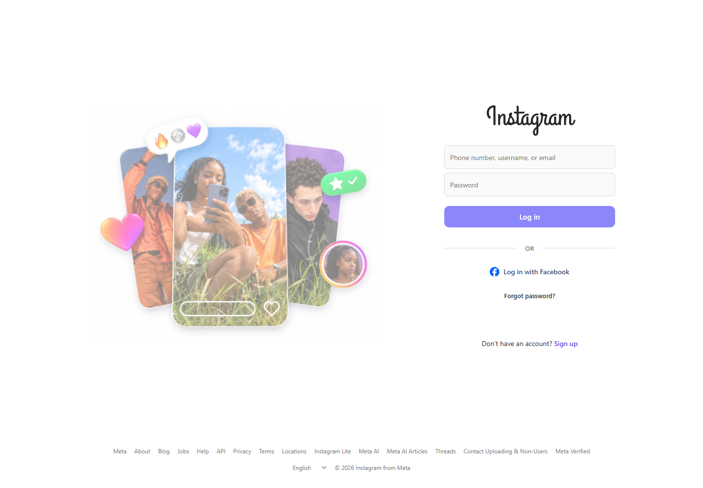

# Instagram-Style Login Page UI

A responsive front-end recreation of Instagram's login interface, built with plain HTML, CSS, and JavaScript. This project is for learning and portfolio demonstration only; it is not Instagram and is not affiliated with or endorsed by Meta.

## Preview

## Features

- Responsive layout for desktop and mobile
- Username and password fields with a show/hide password control
- Demo-only form validation and submission feedback
- No backend, account login, or data collection

## Run locally

No build tools or dependencies are required. Open [`assets/index.html`](assets/index.html) in a browser.

## Important

This is a visual UI demo, not a real sign-in page. The form does not send or save entered information. Do not enter real passwords or personal information. Instagram and its logos are trademarks of Meta; this independent project is not an official service.

## Technologies

HTML · CSS · JavaScript

## Search terms

Instagram-style login page UI, responsive login form, HTML CSS JavaScript interface, Instagram login interface recreation, front-end practice project.
